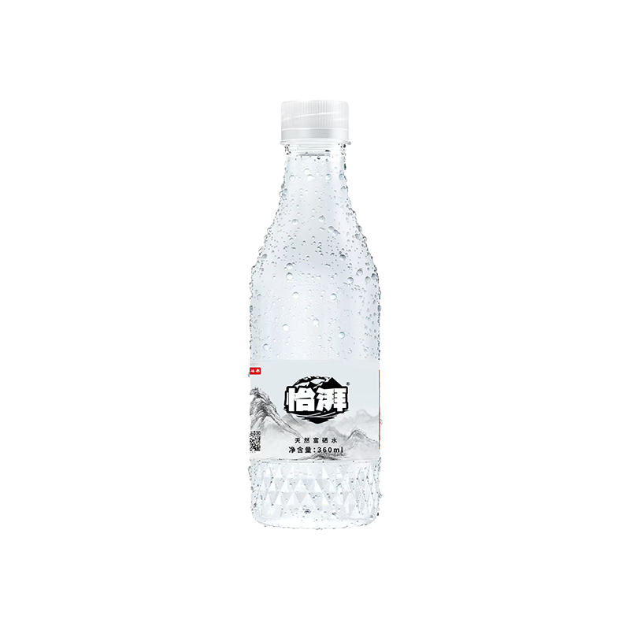
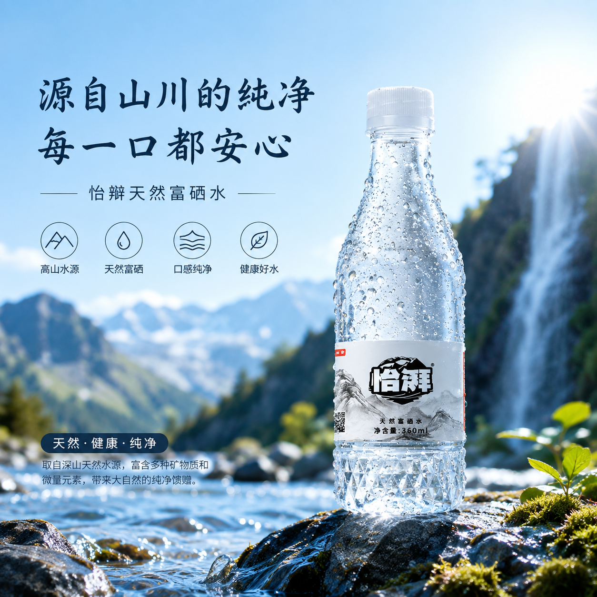

# 案例：产品白底图生成山泉广告海报

使用这个案例理解“参考图生成”与普通改色的区别：输入图只提供产品身份和细节，输出图可以重新设计场景、构图和广告版式，但必须保持产品可识别。

## 输入与结果

输入产品图：`mineral-water-product-input.png`



结果参考：`mineral-water-poster-output.png`



## 推荐 prompt

```text
Image 1 is the only product identity reference. Create a polished square 1:1 Chinese advertising poster for this bottled mineral water.

Preserve the product exactly: bottle silhouette, white cap, transparent plastic, condensation droplets, lower faceted bottle texture, label layout, black-and-white brand mark, QR-code region, and “净含量: 360ml”. Do not invent a different bottle, cap, label, logo, or package shape.

Composition: place one enlarged bottle upright on a wet foreground rock in the right half. Use a bright alpine spring landscape with flowing water, distant blue mountains, a waterfall on the right, natural moss and leaves, and strong morning sunlight from the upper-right corner. Keep the left half clean enough for headline and feature information. Use a cool blue-white palette, crisp commercial product photography, realistic refraction, sparkling water droplets, shallow atmospheric depth, and premium natural-mineral-water advertising aesthetics.

Render the following Chinese text exactly once:
Headline: “源自山川的纯净” / “每一口都安心”
Subheadline: “恰辩天然富硒水”
Feature captions: “高山水源” / “天然富硒” / “口感纯净” / “健康好水”
Badge: “天然·健康·纯净”
Body copy: “取自深山天然水源，富含多种矿物质和微量元素，带来大自然的纯净馈赠。”

Use four minimal line icons for mountain source, water drop, clean taste, and healthy water. Add no people, extra bottles, foreign-language copy, endorsement badges, or unrequested certification marks.
```

## 验收清单

- 产品只有一瓶，瓶型、瓶盖、瓶身水珠、标签和容量信息仍与输入图一致。
- 产品位于右侧前景，左侧文案区层级清楚，山脉、溪流、瀑布和阳光形成自然水源语义。
- 不要把其他参考图的无关背景带入结果，确保模型理解“产品身份参考”而非整图风格复制。
- 中文标题、品牌名、容量和功能文案不得有错字、重字或额外文字；若需要商业级文字准确性，优先生成无字底图后再用确定性排版工具叠字。
- “富硒”“高山水源”“健康”等宣传内容只在用户已确认其真实性和合规性时使用，不要根据产品图片自行编造功效、产地或认证。

结果图只用于展示合格方向，不要求每次生成像素级复刻。根据用户实际品牌、合规文案和投放尺寸改写 prompt。
