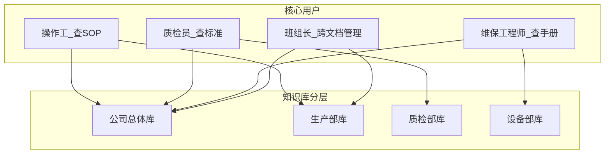

# A-13 百雀羚工厂生产管理 AI 知识库 — 用户画像

> 课题背景：管理经验、设备手册、质检标准散落各部门，AI 引擎整合后可检索可对话。

---

## 画像 1：一线生产操作工

| 维度 | 描述 |
|------|------|
| **姓名** | 李强 |
| **角色** | 灌装线一线操作工 |
| **年龄 / 工龄** | 28 岁，入厂 3 年 |
| **所属部门** | 生产部 |

### 使用场景

- 开班前确认本岗位 SOP 与当日生产参数
- 产线出现异常（灌装量偏差、贴标偏移）时快速查处置步骤
- 换班交接时核对注意事项与遗留问题
- 新员工跟岗时口头传授经验，但口径不统一

### 核心诉求

- 用手机或工位终端**秒级查到**本工序标准操作流程
- 异常发生时能按步骤自助排查，减少等班长或工程师的时间
- 回答要**口语化、步骤清晰**，最好附原文出处便于核对

### 当前做法

- 翻纸质 SOP 夹、微信群问班长
- 打电话找上一班同事或工艺员
- 部分经验存在老员工脑子里，文档更新滞后

### 痛点

- 文档分散在车间文件柜、共享盘、微信群，**找不到或版本不一致**
- 夜班/周末支援人员少，**等待时间长**
- 搜索关键词不准时，传统文件夹检索效率低

### 对 AI 知识库的期望

- 登录后自动进入「生产部」知识范围，问「灌装量超差怎么处理」能给出步骤并引用 SOP
- 只看到自己部门 + 公司通用制度，不混入其他部门无关内容

### 成功标准

- 常见异常问题 **30 秒内** 得到可执行答复
- 回答带来源文档名，班组长认可与现场规程一致

---

## 画像 2：质检员

| 维度 | 描述 |
|------|------|
| **姓名** | 王芳 |
| **角色** | 成品检验员 |
| **年龄 / 工龄** | 32 岁，入厂 6 年 |
| **所属部门** | 质检部 |

### 使用场景

- 抽检时对照《成品检验标准》判定合格与否
- 客户投诉或内审时追溯某指标限值与检测方法
- 新国标或内控标准更新后，确认与旧版差异
- 与生产部对「不合格」认定产生分歧时需有据可查

### 核心诉求

- **精准检索** 某 SKU、某检验项目的标准限值与抽样规则
- 回答必须**可溯源**到正式质检文件，避免「模型胡说」
- 支持对比「公司总体质量方针」与「部门检验细则」

### 当前做法

- 查阅纸质/电子版检验规程、Excel 限值表
- 在 OA 或网盘搜索，文件名不统一难以定位
- 疑难问题请示质量主管或查历史邮件

### 痛点

- 标准文件多版本并存，**易用错版**
- 指标分散在多个附件，**无法一次问清**
- 生产与质检对条款理解不一致，沟通成本高

### 对 AI 知识库的期望

- 选「质检部」后提问，检索范围含公司质量总则 + 质检部标准库
- 回答附条款编号、文档片段，便于截图留痕

### 成功标准

- 抽检现场 **1 分钟内** 查到目标指标及判定规则
- 质量主管抽查 10 个问题，引用准确率 ≥ 90%（原型阶段以样例库为准）

---

## 画像 3：设备维保工程师

| 维度 | 描述 |
|------|------|
| **姓名** | 张伟 |
| **角色** | 设备维保工程师 |
| **年龄 / 工龄** | 35 岁，入厂 8 年 |
| **所属部门** | 设备部 |

### 使用场景

- 设备报警后查手册中的故障代码与处理流程
- 计划性保养时核对保养周期、备件型号与扭矩参数
- 外协或新设备到货，快速熟悉操作与维护要点
- 向生产部说明「能否开机」需依据维保记录与手册条款

### 核心诉求

- 按**设备型号 / 报警代码**检索，而不是死记文件夹路径
- 图文手册中的表格、参数能被结构化检索
- 公司级设备安全规范与单机手册能**合并回答**

### 当前做法

- PDF 手册存在个人电脑、U 盘、设备旁文件夹
- 厂商远程支持，等待时间长
- 经验笔记在纸质本子或私人文档，未纳入知识库

### 痛点

- 手册体积大，**全文搜索弱**或格式乱码
- 同一产线多品牌设备，文档命名混乱
- 夜班故障时资深工程师不在岗，**排障慢**

### 对 AI 知识库的期望

- 设备部专属库含各机台手册、维保记录模板、常见故障案例
- 问「贴标机 E12 报警」返回排查顺序 + 手册页码/章节引用

### 成功标准

- 常见报警码问题 **2 分钟内** 获得排查路径
- 减少重复性电话咨询，维保记录填写更规范

---

## 画像 4：生产班组长 / 主管

| 维度 | 描述 |
|------|------|
| **姓名** | 陈明 |
| **角色** | 灌装车间班组长 |
| **年龄 / 工龄** | 38 岁，入厂 12 年 |
| **所属部门** | 生产部（管理岗） |

### 使用场景

- 班前会传达公司最新生产与安全要求
- 协调生产、质检、设备三方对同一问题的处理口径
- 带新人上岗，统一传授 SOP 与现场管理经验
- 突发停线时快速查应急预案与上报流程

### 核心诉求

- **跨文档整合**：一次提问同时命中 SOP、安全制度、管理经验摘要
- 能切换或汇总「公司总体」与「本部门」知识，便于对上汇报
- 答案权威、可转发给班组，减少重复解释

### 当前做法

- 靠个人经验 + 多处翻文件
- 建立班组微信群，重复回答同类问题
- 重要变更依赖培训会，**落地慢**

### 痛点

- 知识在人不在系统，**人员流动即知识流失**
- 各部门文档各管各的，**协调成本高**
- 新人培养周期长，班长精力被重复答疑占用

### 对 AI 知识库的期望

- 登录选部门后，既能问部门细则，也能问公司级制度
- 支持「给新人讲解灌装线开班流程」这类**归纳型**问答
- 历史问答可回顾（原型可先做会话列表）

### 成功标准

- 班组常见 20 类问题可由 AI 首轮解答，班长复核即可
- 新人独立上岗辅导时间缩短（研学阶段以问卷/演示验收）

---

## 画像关系小结

| 画像 | 首要知识范围 | 典型问法 |
|------|--------------|----------|
| 李强（操作工） | 生产部 + 公司总体 | 「灌装量偏差超 2% 怎么办？」 |
| 王芳（质检员） | 质检部 + 公司总体 | 「护手霜外观气泡缺陷判定标准？」 |
| 张伟（维保） | 设备部 + 公司总体 | 「旋盖机过载报警处理步骤？」 |
| 陈明（班组长） | 生产部 + 公司总体 | 「停线后复工前检查清单有哪些？」 |
