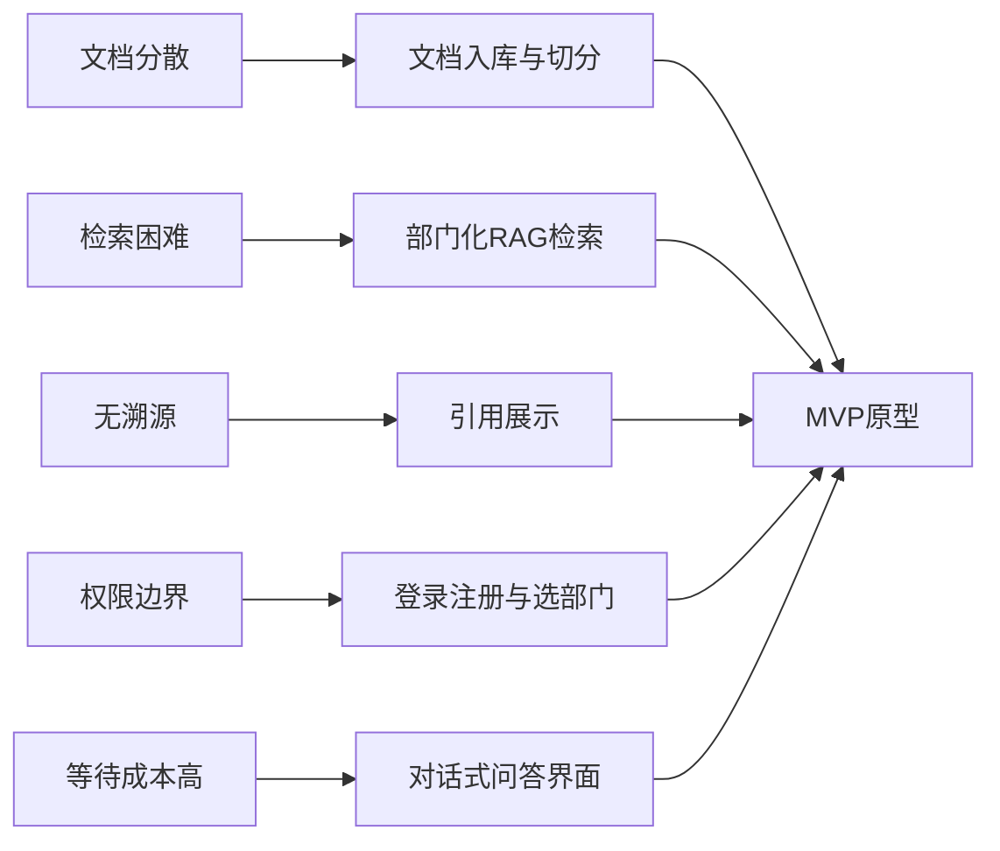

# A-13 百雀羚工厂生产管理 AI 知识库 — 同理心地图

> 对应 [`01-用户画像.md`](01-用户画像.md) 中的四个核心角色。  
> 四象限：**所想 Think** / **所说 Say** / **所做 Do** / **所感 Feel**

---

## 1. 一线生产操作工 · 李强

| 所想 Think | 所说 Say |
|------------|----------|
| 「这个异常以前见过，但记不清具体步骤了」 | 「班长在吗？灌装量又偏了怎么办？」 |
| 「文档是不是又更新了？我手里这份对不对？」 | 「群里谁有最新 SOP？发我一份」 |
| 「别耽误产量，最好能自己先搞定」 | 「等工艺员来要半小时，产线不能一直停」 |
| 「夜班就几个人，不好意思总麻烦别人」 | 「上次老王说的办法和文件上写的不一样」 |

| 所做 Do | 所感 Feel |
|---------|-----------|
| 翻工位旁纸质 SOP 夹、拍照片发微信群 | **焦虑**：怕操作不当被追责 |
| 凭经验先试几步，不行再打电话 | **无助**：信息散、找不到权威答案 |
| 用个人手机在网盘里搜文件名 | **急躁**：停线每分钟都在计损失 |
| 向上一班同事口头确认注意事项 | **依赖**：知识绑在人身上，不在系统里 |

---

## 2. 质检员 · 王芳

| 所想 Think | 所说 Say |
|------------|----------|
| 「这个指标限值到底以哪份文件为准？」 | 「请把你们用的检验规程版本发我对一下」 |
| 「判定要有依据，不能凭感觉」 | 「这条不合格，条款在规程第几章？」 |
| 「生产总想放宽标准，我得守住底线」 | 「内控比国标严，按我们公司文件来」 |
| 「客户投诉追溯时，每一句都要有出处」 | 「把当时执行的抽样方案截图给我」 |

| 所做 Do | 所感 Feel |
|---------|-----------|
| 打开多个 Excel / PDF 对照限值 | **严谨**：怕用错版标准 |
| 在 OA、网盘用关键词搜索规程 | **疲惫**：同一问题反复查、反复确认 |
| 与生产部现场确认样品并拍照留痕 | **压力**：质量红线不能踩错 |
| 疑难样品请示质量主管并邮件备案 | **挫败**：明明有文件却搜不到关键句 |

---

## 3. 设备维保工程师 · 张伟

| 所想 Think | 所说 Say |
|------------|----------|
| 「这个报警码见过，手册里在第几章来着？」 | 「先别强行开机，我查一下手册」 |
| 「备件型号不能错，换错更麻烦」 | 「扭矩多少？我翻一下保养表」 |
| 「厂商远程要排队，自己能搞定最好」 | 「这台机子的 PDF 在我 U 盘里，等下」 |
| 「要把排障步骤写进记录，下次新人能用」 | 「这类故障上个月处理过，我笔记本里有」 |

| 所做 Do | 所感 Feel |
|---------|-----------|
| 携带 U 盘、平板到机台旁查 PDF | **紧迫**：故障停线，时间压力大 |
| 对照纸质保养计划打勾执行 | **孤立**：经验在个人笔记，团队共享弱 |
| 电话请教资深同事或厂商技术支持 | **无奈**：文档多、格式乱，搜索体验差 |
| 手写维保记录，部分案例未电子化 | **责任重**：安全与设备完好都压在自己身上 |

---

## 4. 生产班组长 / 主管 · 陈明

| 所想 Think | 所说 Say |
|------------|----------|
| 「公司新要求下来了，班组里怎么落地？」 | 「班前会我再说一遍，大家记一下」 |
| 「生产、质检、设备说法不一，得统一口径」 | 「以这份文件为准，别各说各的」 |
| 「新人问的问题，八成老员工也问过」 | 「有问题先问班长，别各自乱操作」 |
| 「知识不能只在我脑子里，得留下来」 | 「这套经验我带了十年，得写下来」 |

| 所做 Do | 所感 Feel |
|---------|-----------|
| 班前会口头传达制度与注意事项 | **疲惫**：重复答疑占用管理时间 |
| 在多个群、文件夹间协调信息 | **割裂**：各部门文档不互通 |
| 亲自带新人跟岗、手把手教 | **担忧**：人员流动导致班组能力下降 |
| 突发停线时打电话多方确认流程 | **责任大**：安全、产量、质量都要顾 |

---

## 痛点 → 机会点对照

| 共性痛点 | 用户心声（概括） | MVP 机会点 |
|----------|------------------|------------|
| 文档分散、版本混乱 | 「到底以哪份为准？」 | 统一入库 + 元数据（部门、版本、文档类型） |
| 检索效率低 | 「知道有，就是找不到」 | RAG 语义检索 + 关键词混合检索 |
| 知识绑在个人 | 「还得问老王」 | 结构化抓取 SOP / 手册 / 标准进知识库 |
| 跨部门口径不一 | 「生产和质检文件对不上」 | **公司总体库** 与 **部门库** 分层，回答可引用多方条款 |
| 缺乏溯源 | 「你说的话有依据吗？」 | 回答附 **来源文档名 + 片段引用** |
| 场景与权限不清 | 「别的部门资料不该给我看」 | **登录注册 + 选部门**，检索过滤 `company ∪ 当前部门` |
| 等待成本高 | 「人等信息，信息等人」 | 对话式问答，30 秒级响应（原型目标） |
| 管理经验难沉淀 | 「班长走了经验就没了」 | 预留「管理经验」文档类型，纳入部门库 ingest |

### 机会点与功能映射

| MVP 功能 | 解决谁的痛点 | 验收方式（研学） |
|----------|--------------|------------------|
| 登录 / 注册 | 全员：身份与默认部门 | 可注册账号并登录 |
| 选择部门 | 全员：限定知识范围 | 切换部门后回答内容变化 |
| 公司总体 + 部门 RAG | 四人画像共性 | 问部门问题命中部门库；问制度命中公司库 |
| 引用溯源 | 质检员、班组长强需求 | 回答展示 `source_doc` / `chunk` |
| 样例文档入库 | 操作工、维保 | 预置 2～3 类样例文档可问答 |

---

## 设计启示（给产品与开发）

1. **默认部门**：注册时绑定部门，减少每次选择成本；会话内允许切换（班组长场景）。
2. **回答风格**：操作工、维保偏「步骤列表」；质检偏「条款 + 限值」；班组长偏「要点归纳」。
3. **检索策略**：永远包含 `company` 范围；部门私有库严格隔离，避免质检标准泄露到无关部门问答上下文（原型用 metadata 过滤即可）。
4. **信任建立**：首屏提示「回答基于内部文档，请以引用原文为准」，降低对幻觉的容忍落差。
